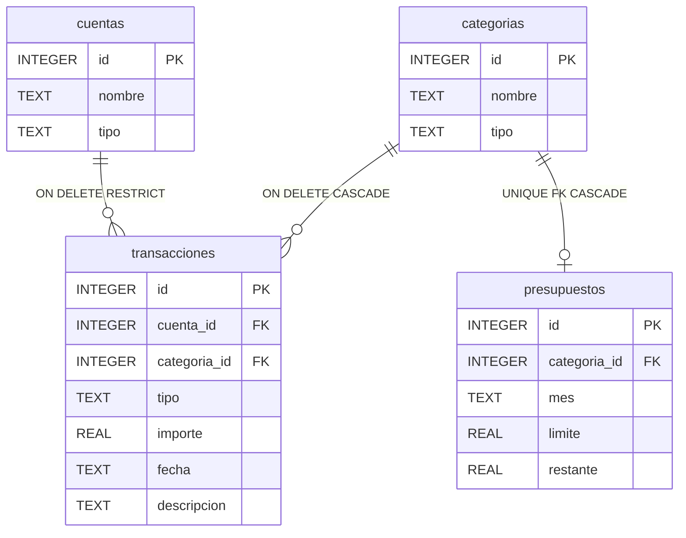

# Diseno de Base de Datos Movil

Trabajo: Ejemplo de implementacion de una aplicacion con almacenamiento movil para iOS  
Asignatura: CBD (Bases de Datos), Grado en Ingenieria del Software, Universidad de Sevilla  
Fecha: 2026-04-06

## Modelo Entidad-Relacion

En la Figura 1 se muestra el modelo E/R de la aplicacion financiera, con cardinalidades y restricciones de integridad referencial.

*Figura 1*. Diagrama entidad-relacion de la base de datos de la aplicacion financiera.  
*Nota.* Elaboracion propia.

## Descripcion de Entidades

| Entidad | Proposito | Restricciones clave |
|---|---|---|
| cuentas | Almacena las cuentas del usuario (efectivo, banco, tarjeta). | `tipo` con `CHECK`; eliminacion restringida si existen transacciones asociadas. |
| categorias | Define categorias para ingresos y gastos. | `nombre` unico; eliminacion en cascada hacia transacciones y presupuestos. |
| transacciones | Registra operaciones financieras con importe, fecha y tipo. | FK `cuenta_id` con `ON DELETE RESTRICT`; FK `categoria_id` con `ON DELETE CASCADE`; `importe > 0`. |
| presupuestos | Gestiona limite y restante por categoria y mes. | `categoria_id` con FK y `UNIQUE` para un presupuesto activo por categoria. |

## Decisiones de Diseno

- `transacciones.cuenta_id` usa `ON DELETE RESTRICT` para proteger el historial financiero y evitar perder trazabilidad de movimientos.
- `transacciones.categoria_id` usa `ON DELETE CASCADE` para mantener consistencia cuando una categoria deja de existir.
- `presupuestos.categoria_id` incluye `UNIQUE` para asegurar un presupuesto activo por categoria y evitar duplicidades logicas.