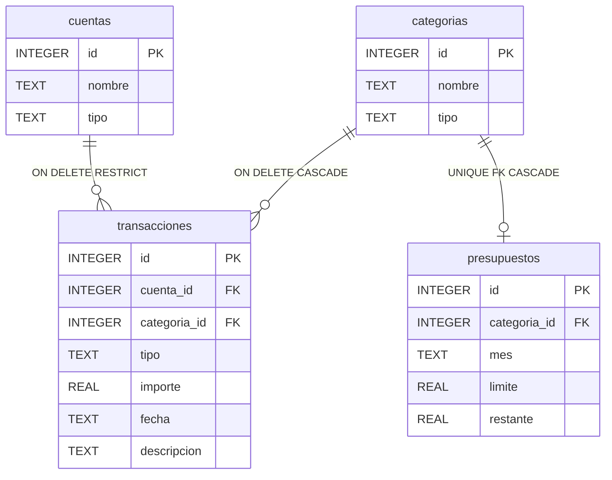

La metodologia aplicada sigue una secuencia de diseno de base de datos movil: seleccion de plataforma, seleccion del SGBD local, definicion del modelo transaccional, optimizacion por indices y modelado E/R con traduccion a esquema fisico SQL [1], [3].

## Seleccion de Plataforma y SGBD

La plataforma seleccionada es React Native con Expo SDK 54 y `expo-sqlite`, lo que permite iterar en Expo Go sin build nativo en cada ciclo y, al mismo tiempo, mantener un motor SQL embebido para validacion academica de restricciones, triggers y agregaciones [3].

## Modelo Entidad-Relacion

En la Figura 1 se puede observar el esquema E/R de la base de datos para cuentas, categorias, transacciones y presupuestos.



*Figura 1*. Diagrama Entidad-Relacion de la base de datos de la aplicacion financiera.  
*Nota.* Elaboracion propia.

El modelo define tres relaciones clave: (1) cuenta a transacciones con `ON DELETE RESTRICT` para proteger historico, (2) categoria a transacciones con `ON DELETE CASCADE` para evitar registros huerfanos, y (3) categoria a presupuestos con restriccion `UNIQUE` para mantener un presupuesto activo por categoria.

## Esquema Fisico SQL (DDL)

El esquema fisico se implementa mediante el siguiente DDL SQL, ejecutado en la funcion `migrateDbIfNeeded` al iniciar la aplicacion.

```sql
CREATE TABLE IF NOT EXISTS cuentas (
  id      INTEGER PRIMARY KEY AUTOINCREMENT,
  nombre  TEXT    NOT NULL,
  tipo    TEXT    NOT NULL CHECK(tipo IN ('efectivo', 'banco', 'tarjeta'))
);

CREATE TABLE IF NOT EXISTS categorias (
  id     INTEGER PRIMARY KEY AUTOINCREMENT,
  nombre TEXT    NOT NULL UNIQUE,
  tipo   TEXT    NOT NULL CHECK(tipo IN ('ingreso', 'gasto'))
);

CREATE TABLE IF NOT EXISTS transacciones (
  id           INTEGER PRIMARY KEY AUTOINCREMENT,
  cuenta_id    INTEGER NOT NULL REFERENCES cuentas(id)    ON DELETE RESTRICT,
  categoria_id INTEGER NOT NULL REFERENCES categorias(id) ON DELETE CASCADE,
  tipo         TEXT    NOT NULL CHECK(tipo IN ('ingreso', 'gasto')),
  importe      REAL    NOT NULL CHECK(importe > 0),
  fecha        TEXT    NOT NULL DEFAULT (date('now')),
  descripcion  TEXT
);

CREATE TABLE IF NOT EXISTS presupuestos (
  id           INTEGER PRIMARY KEY AUTOINCREMENT,
  categoria_id INTEGER NOT NULL UNIQUE REFERENCES categorias(id) ON DELETE CASCADE,
  mes          TEXT    NOT NULL,
  limite       REAL    NOT NULL CHECK(limite > 0),
  restante     REAL    NOT NULL
);
```

La estructura anterior se alinea con el comportamiento esperado de SQLite para integridad declarativa y control transaccional en aplicaciones embebidas [3].

## Logica de la Base de Datos (Triggers e Indices)

El trigger principal de negocio aplica consistencia automatica sobre presupuestos cuando se registra un gasto:

```sql
CREATE TRIGGER IF NOT EXISTS actualizar_presupuesto_tras_gasto
AFTER INSERT ON transacciones
WHEN NEW.tipo = 'gasto'
BEGIN
  UPDATE presupuestos
  SET    restante = restante - NEW.importe
  WHERE  categoria_id = NEW.categoria_id;
END;
```

Esta regla evita que la capa de interfaz tenga que recalcular saldos manualmente y mantiene coherencia en el almacenamiento. Para rendimiento, se crean los indices `idx_txn_fecha` e `idx_txn_categoria`, y para analitica se define la vista `resumen_mensual` con agregaciones `SUM/GROUP BY`.

```sql
CREATE INDEX IF NOT EXISTS idx_txn_fecha     ON transacciones(fecha);
CREATE INDEX IF NOT EXISTS idx_txn_categoria ON transacciones(categoria_id);
```

## Habilitacion de la Integridad Referencial

SQLite requiere habilitar explicitamente claves foraneas en cada conexion, por lo que `PRAGMA foreign_keys = ON` se ejecuta como primer comando dentro de `migrateDbIfNeeded` para asegurar que `CASCADE` y `RESTRICT` se apliquen de forma efectiva [3].

```sql
PRAGMA foreign_keys = ON;
```

Referencias IEEE citadas en esta seccion:
[1] V. Kumar, *Mobile Database Systems*. Wiley, 2006.
[3] M. Owens, *The Definitive Guide to SQLite*, 2nd ed. Apress, 2010.